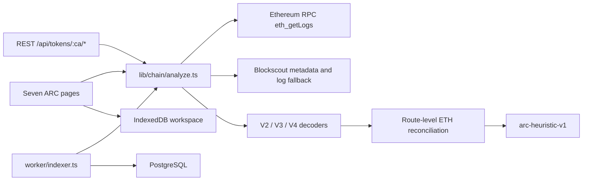

# Architecture

The browser and the server call the same analyzer. GitHub Pages ships the static UI, so indexing runs in the visitor’s browser against public RPCs and stores snapshots in IndexedDB. Docker runs the same function behind Next.js route handlers and an optional Postgres worker.

Synthetic fixtures live only in `lib/data.ts` and render when Settings turns demo mode on. `analyzeToken` does not import them.

## Pipeline

1. Read ERC-20 `name`, `symbol`, and `decimals` from the contract.
2. Resolve canonical Uniswap V2 `getPair`, Uniswap V3 `getPool`, SushiSwap `getPair`, and Uniswap V4 `Initialize` logs. Dexscreener hints are verified on-chain before use.
3. Find T0: the first swap after liquidity that is not in the liquidity transaction.
4. Pull `Swap`, `Mint`, and `Burn` logs for the launch-relative, trailing, or absolute window (1–10,080 minutes).
5. Collapse multihop routes so WETH is counted once. Non-WETH routes without a WETH hop stay `unsupported`.
6. Label the deployer and the first LP signer as project wallets. Their swaps stay in the audit table and leave the independent KPI.
7. Score sniper, scanner, copy, momentum, arbitrage, and sandwich patterns with HIGH / MEDIUM / LOW / UNKNOWN. Those words are ordinal evidence, not probabilities.

## Persistence

| Surface | Store |
|---|---|
| Browser | IndexedDB database `arc-launch-intelligence` |
| Worker | `db/migrations/001_init.sql` via Drizzle table mirrors in `db/schema.ts` |
| Reorg | If the checkpoint block hash changes, rows from `height - 64` are deleted and the token is indexed again |
